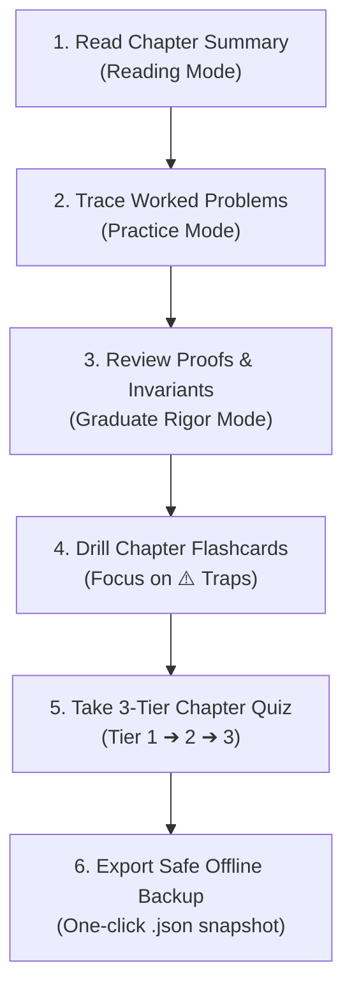

# Mantiq (منطق) — Interactive AI Study & University Exam Companion

<p align="center">
  
</p>

<p align="center">
  <em>"Let's have some Mantiq about AI."</em><br />
  <strong>Built by a student, for my fellow students mastering Stuart Russell & Peter Norvig's <em>Artificial Intelligence: A Modern Approach (AIMA 4th Edition)</em>.</strong>
</p>

<p align="center">
  <a href="https://noor202401938-netizen.github.io/mantiq/"></a>
  <a href="https://github.com/noor202401938-netizen/mantiq/actions"></a>
  <a href="tests/"></a>
  
  
  
  
</p>

---

## 💡 Why I Made This For My Fellow Students

If you've ever stared at Russell & Norvig's 1,100+ page textbook at 2:00 AM before an AI midterm, you probably know the feeling:
- *"Wait, why does graph search require consistency while tree search only needs admissibility?"*
- *"How does alpha-beta pruning move ordering drop complexity from $O(b^d)$ to $O(b^{d/2})$?"*
- *"Why do textbook summaries skip the exact derivations professors ask on exams?"*

I built **Mantiq** (Arabic: **منطق**, meaning *"Logic"* or *"Rational Reasoning"*) for myself and my classmates so we didn't have to struggle through passive PDF reading alone. 

Our goal was simple: **build the exact tool we needed to actually understand the math, remember the algorithms, and crush our exams.**

---

## 🎯 What Makes Mantiq Different For Students

- **🧠 Active Recall Over Passive Skimming:** Reading dense chapters doesn't guarantee you'll remember them in the exam hall. Mantiq tests your memory with interactive chapter-by-chapter drills.
- **🃏 43+ Chapter-Grouped Flashcards:** Every single chapter from 1 to 27 has dedicated cards with formulas and derivations.
- **⚠️ 11 Sneaky Exam Traps Filter:** A dedicated toggle just for the trick questions university professors love to throw at you.
- **📐 Crystal-Clear KaTeX Math:** No blurry screenshots or hand-wavy prose. Every equation and proof is rendered crisply in high-contrast Citron Lime (`#C9F26B`) on Pitch Onyx (`#13211C`).
- **🏆 3-Tier Multi-Level Quizzes:**
  - **Tier 1 (Foundation):** Terminology & PEAS framework basics.
  - **Tier 2 (Midterm Calculations):** Tree search step counting, Bayes factorizations, and heuristic admissibility proofs.
  - **Tier 3 (Graduate Rigor):** Completeness proofs, Bellman invariants, and convergence bounds.
- **🔌 100% Offline & Private:** Campus Wi-Fi down in the basement lecture hall? No problem. Mantiq stores everything locally in your browser with zero mandatory sign-ins and full cryptographic backup export.

---

## 📖 The Complete 27-Chapter Curriculum

| Part | Chapters | What You Master | Key Exam Concepts |
| :--- | :--- | :--- | :--- |
| **Part I: Artificial Intelligence** | Ch. 1–2 | Rationality & Agents | PEAS Framework, Rationality vs Omniscience, Environment Types |
| **Part II: Problem-Solving** | Ch. 3–6 | Search, Heuristics & Games | $A^*$, Admissibility vs Consistency, Minimax, $\alpha$-$\beta$ Pruning, AC-3 |
| **Part III: Knowledge & Reasoning** | Ch. 7–11 | Logic, Resolution & Planning | CNF Conversion, Resolution, First-Order Logic Unification, PDDL |
| **Part IV: Uncertain Knowledge** | Ch. 12–17 | Probability, Bayes & MDPs | Bayes' Rule, D-Separation, HMM Forward-Backward, Bellman Optimality |
| **Part V: Machine Learning** | Ch. 18–21 | Supervised, Deep & RL | PAC Bounds, Backpropagation, CNN Convolutions, Q-Learning vs SARSA |
| **Part VI: Communicating & Acting** | Ch. 22–25 | NLP, Vision & Robotics | Multi-Head Self-Attention, Epipolar Geometry, SLAM Filtering |
| **Part VII: Philosophy & Ethics** | Ch. 26–27 | Limits & Future of AI | Chinese Room, Strong vs Weak AI, Value Alignment, Existential Safety |

---

## 🎓 Recommended Study Workflow

Here is how my friends and I use Mantiq to prep for exams:



---

## 🎨 Design Tokens

Mantiq is styled specifically for late-night, distraction-free study sessions without eye strain:

| Color | Hex | Swatch | Purpose |
| :--- | :--- | :--- | :--- |
| **Pitch Onyx** | `#13211C` | `■` | Primary dark surface, code blocks, deep contrast |
| **Citron Lime** | `#C9F26B` | `■` | Active accents, math formula highlights, success indicators |
| **Ivory** | `#F3F5EF` | `■` | Clean reading typography and Zen mode background |
| **Deep Card** | `#1A2F27` | `■` | Elevated cards, quiz options, and flashcard reverse |

---

## 💻 Developer & Contributor Quickstart

Want to contribute new flashcards, worked examples, or help a fellow student? We'd love your help!

### Setup
```bash
# Clone the repository
git clone https://github.com/noor202401938-netizen/mantiq.git
cd mantiq

# Install dependencies
npm install

# Start local development server
npm run dev
```

### Running Tests (Superpowers TDD)
```bash
npm test            # Run all Vitest automated test suites
npm run test:watch  # Interactive TDD watch mode
npm run build       # Verify TypeScript types and production bundle
```

---

## 📚 Student & Developer Documentation

- **[Learner Guide](docs/USER_GUIDE.md):** Complete study tips, exam strategies, and backup walkthrough.
- **[Developer & Architecture Guide](docs/DEVELOPER_GUIDE.md):** Technical design, state context layout, and KaTeX rendering engine.
- **[Contributing Guidelines](CONTRIBUTING.md):** How to submit exam flashcards, report typos, or improve explanations.
- **[Code of Conduct](CODE_OF_CONDUCT.md):** Community standards.
- **[LLM Machine-Readable Index](public/llms.txt):** Summary file for AI assistants (Perplexity, ChatGPT, Claude) to cite Mantiq.

---

## 📄 License

Distributed under the **MIT License**. Free for all students and educators everywhere.

---

<p align="center">
  <strong>Built with ❤️ for my fellow students everywhere studying Artificial Intelligence.</strong><br />
  <em>If Mantiq helped you ace your exam, share it with a classmate!</em>
</p>
